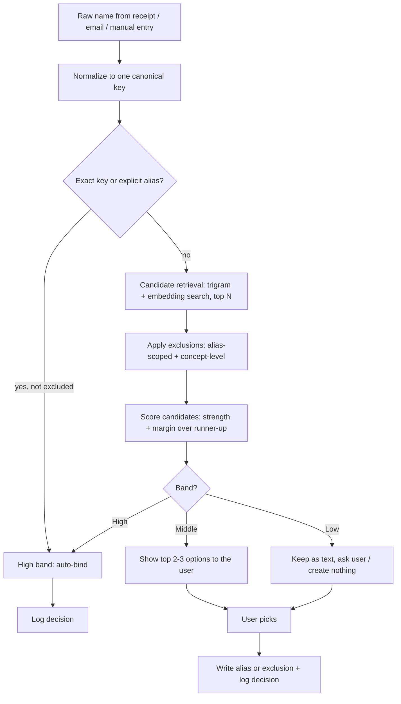

# StuffIt: Entity Matching and Confidence Scoring Design

_Date: Nov 11, 2026. Scope: how StuffIt_API resolves stores, brands, return policies, and warranties from user input (receipts, emails, manual entry), and the proposed target design._

Related: the full code review in `docs/code-review/CODE_REVIEW.md` ([PR #1](https://github.com/stevewash123/StuffIt_API/pull/1)), section "Design concepts: entity resolution and matching."

---

## 1. Current state (from the code review)

**Verdict: it will not hold up at scale.** It works today because the catalog is small and curated (about 98 sellers and 199 manufacturers, no seller-key collisions in the shipped reference data).

How matching works today:

- The document reader returns a store or brand **string**. It does not resolve the merchant.
- Binding is fully deterministic: `FactResolver.Key`, then exact alias, then word prefix, then whole-word brand match, then keyword category.
- There is **no AI fallback for merchant resolution**. The only model step is `MakerLineClassifier`, which picks among one brand's warranty lines after the brand is already chosen.
- On a miss, the name stays as text or the reader inserts a private party as a side effect.

Wrong matches already implied by the seed data:

| Input | Bound to | Why |
|---|---|---|
| `Target Practice Supplies` | Target | `StoreNameMatcher` applies a prefix match that `AliasMatcher` treats as a non-match |
| `Smith & Wesson` | Smith Optics | Longest-name rule only helps when both names match the same line |
| `Echo Dot` | Echo (outdoor equipment), lawn & garden | Manufacturer default category ignores the item text |
| `K2` | K2 brand anywhere | Two-letter tokens are legal brand matches |
| `SAMS CLUB #6452` vs `Sam's Club` | Same key in matcher, different keys in duplicate check (`NameKey`) | Two different normalizers |

Structural problems:

- Every lookup loads **all** sellers or manufacturers and scans alias lists in memory.
- Confidence is a single number with **no record of which rule fired** or what the runner-up was.
- User corrections are **not fed back**: no negative alias is written, so the next receipt repeats the mistake.

---

## 2. Design principles

1. **Exclusions are about meaning, not words.** "Not Gun" must also exclude rifle, shotgun, ammo, bullet, target practice. String rules and spelling-based fuzzy matching (Levenshtein, trigram) cannot do this; "rifle" looks nothing like "gun."
2. **"Close call" is relative**, so the real mechanism is confidence scoring with thresholds, not a fixed rule order.
3. **When it's genuinely ambiguous, ask the user.** Their pick is ground truth and becomes stored knowledge.
4. **The expensive, non-deterministic step (an LLM) runs rarely**, only on a small candidate list, and never silently binds.
5. **Every decision is recorded** so thresholds are tuned from data, not guessed.

---

## 3. Target pipeline



### 3.1 Normalization
- One normalizer used everywhere (matcher **and** duplicate check). Fixes the `SAMS CLUB #6452` / `Sam's Club` split.
- Lowercase, strip punctuation, store numbers (`#6452`), legal suffixes (Inc, LLC), common receipt noise.

### 3.2 Exact lookup
- `merchant_alias` table with a unique index on `normalized_key`. Exact match becomes one indexed lookup, not a full scan.
- Explicit aliases (curated or user-confirmed) bind directly unless an exclusion applies.
- **Word-prefix matches no longer auto-bind.** They become candidates.
- Short or common tokens (`K2`, `Echo`, `Smith`, `Target`, `Apple`) are flagged `restricted`: they can never match as a prefix or mid-line, only as an exact full key.

### 3.3 Candidate retrieval (meaning, not spelling)
- **Trigram (`pg_trgm`)** for spelling variants and OCR noise.
- **Embeddings (`pgvector`, in Neon)** for meaning: one vector per merchant/brand (name + category + description) and per item line.
- Retrieve top N (e.g. 5) candidates in one indexed query each. Deterministic and cheap.

### 3.4 Exclusions
Two kinds:

| Kind | Example | Stored as | Effect |
|---|---|---|---|
| **Alias-scoped** | `Target Practice Supplies` is not Target | `merchant_exclusion(merchant_id, normalized_key)` | That exact input never binds to that merchant again |
| **Concept-level** | Target: not firearms | `merchant_concept_exclusion(merchant_id, concept_id)` where the concept has an embedding ("firearms, guns, rifles, shotguns, ammunition, bullets, target shooting") | Any input or item line semantically close to the concept is excluded for that merchant |

One concept exclusion covers the whole family (gun, rifle, bullet, shotgun, ammo) without listing words. The `ExcludeKeyName` idea becomes the alias-scoped kind, populated mostly from real user corrections rather than guesses.

### 3.5 Confidence scoring
Each candidate gets a score built from two dimensions:

- **Strength**: how good the top candidate is on its own (e.g. weighted combination of exact/alias hit, trigram similarity, embedding similarity, category agreement with item text, prior user confirmations for this key).
- **Margin**: how far ahead it is of the runner-up. A strong top match with a close second is still ambiguous.

Bands:

| Band | Condition (initial, to be tuned) | Action |
|---|---|---|
| **High** | Exact key/alias, or strength ≥ T_high **and** margin ≥ M_min | Auto-bind |
| **Middle** | Strength ≥ T_low but margin < M_min, or strength between T_low and T_high | Show top 2-3 options to the user |
| **Low** | Strength < T_low | Keep as text, ask the user; create no party |

Thresholds can differ by **stakes**: binding a warranty or return policy needs a higher bar than tagging a category.

### 3.6 Role of the AI model
- **Interactive flows**: the user decides close calls. The model may only **order** the options (put the likelier one first) and explain why.
- **Background flows with no user present** (e.g. email ingest): the model may **rank** the short candidate list, but the item is **flagged for review**, never bound silently.
- The model never generates a merchant name free-form and never creates a party.
- Log model input candidates, choice, and rationale.

### 3.7 Feedback loop
- A user pick in the Middle or Low band writes a confirmed alias (positive) for the chosen merchant.
- Rejecting a suggested match writes an alias-scoped exclusion (negative).
- Repeated rejections of the same merchant for similar items propose a concept-level exclusion for admin review.
- Result: the same input is never ambiguous twice, and model calls trend down over time.

### 3.8 Observability and tuning
Store every resolution in a `match_decision` table:

| Column | Purpose |
|---|---|
| input_raw, input_normalized | What came in |
| rule_fired | exact / alias / trigram / embedding / model / user |
| top_candidate_id, top_score | Winner |
| runner_up_id, runner_up_score | Margin |
| band | High / Middle / Low |
| final_choice_id, chosen_by | What was actually bound and by whom (system / user / model) |
| stakes | category / policy / warranty |
| created_at | When |

Tuning: if users frequently choose the runner-up within a score range, raise the threshold there. If Middle-band users almost always accept option 1, lower it. Review weekly at first.

---

## 4. Proposed schema (sketch)

```sql
create extension if not exists pg_trgm;
create extension if not exists vector;

create table merchant_alias (
  id bigserial primary key,
  merchant_id bigint not null references merchant(id),
  normalized_key text not null,
  source text not null,          -- curated | user_confirmed | imported
  restricted boolean not null default false,
  unique (normalized_key, merchant_id)
);
create index on merchant_alias using gin (normalized_key gin_trgm_ops);

create table merchant_embedding (
  merchant_id bigint primary key references merchant(id),
  embedding vector(1536) not null
);

create table exclusion_concept (
  id bigserial primary key,
  label text not null,           -- e.g. "firearms"
  description text not null,     -- "guns, rifles, shotguns, ammunition, target shooting"
  embedding vector(1536) not null
);

create table merchant_exclusion (
  merchant_id bigint not null references merchant(id),
  normalized_key text not null,
  primary key (merchant_id, normalized_key)
);

create table merchant_concept_exclusion (
  merchant_id bigint not null references merchant(id),
  concept_id bigint not null references exclusion_concept(id),
  threshold real not null default 0.8,
  primary key (merchant_id, concept_id)
);

create table match_decision ( ... as in 3.8 ... );
```

The same pattern (alias, embedding, exclusion, decision log) applies to manufacturers and to policy/warranty line selection.

---

## 5. Migration path

| Stage | Change | Risk | Payoff |
|---|---|---|---|
| 1 | Log `match_decision` (rule fired, score, runner-up) from the current matchers | None | Baseline data for tuning |
| 2 | Single normalizer; `merchant_alias` table with unique index; replace in-memory scans | Low | Fixes Sam's Club split; removes full-table loads |
| 3 | Stop auto-binding prefixes; restrict short/common tokens; Middle band shows options | Low-medium (more prompts at first) | Stops Target/Smith/Echo/K2 mis-binds |
| 4 | Write positive aliases and alias-scoped exclusions from user picks | Low | Mistakes don't repeat |
| 5 | Add `pg_trgm` and `pgvector` candidate retrieval; concept-level exclusions | Medium | Handles meaning ("Not Gun" covers rifle, ammo) |
| 6 | Model ranks short lists in background flows, flagged for review | Medium | Handles the long tail without silent errors |
| 7 | Tune thresholds per stakes from `match_decision` data | Low | Fewer prompts with the same accuracy |

Stages 1-4 need no AI and fix every concrete mis-match found in the review. Stages 5-6 add semantic matching only where the data shows it's needed.

---

## 6. Open questions
- Which embedding model, and should merchant embeddings include category and typical product lines?
- Default threshold values before there's tuning data (suggest starting conservative: more Middle-band prompts).
- Who reviews proposed concept-level exclusions: admin only, or per business account?
- Should business accounts have their own alias/exclusion overrides on top of the global catalog?
